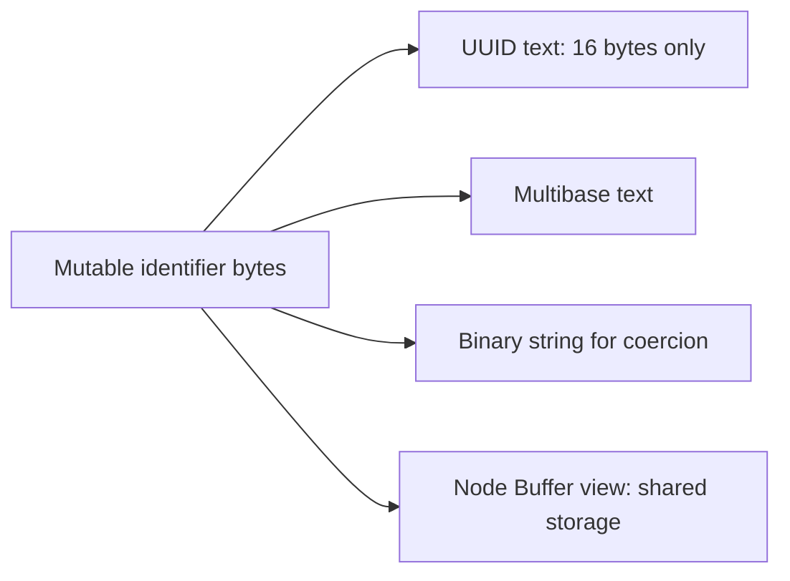

# ADR-0001: Identifier Values and Representations

## Status

Accepted. This contract does not itself claim release or verified conformance.

## Context

### Background and Problem Statement

Consumers use both UUID-sized identifiers and arbitrary-length byte identifiers.
The same bytes can have binary, UUID, multibase, or typed text representations.
Entity meaning, storage, and authorization belong to their respective domains.

### Current Limitations

The existing identifier is a mutable byte-array subclass. Zero-copy conversions
and coercion are observable. Type parameters do not independently validate
bytes. Some existing sortable values carry a pre-standard version-7 timestamp
layout.

## Decision Drivers

### Primary Decision Drivers

- Preserve a binary-first model without equating every identifier with a UUID.
- Provide standards-conformant UUID generation and unambiguous validation.

### Secondary Decision Drivers

- Support compact representations and domain-specific type distinctions.
- Make ownership and security boundaries explicit across runtimes.

## Considered Options

### Option 1: Binary-first identifier values

**Description:** Separate bytes, generator profiles, and representations.

**Technical Characteristics:** UUIDs are a 16-byte profile, not the only value.

**Advantages:** Arbitrary-length identifiers and interoperable UUIDs coexist.

**Disadvantages:** Callers must choose and validate the relevant profile.

**Risk Assessment:** Unchecked mutable bytes can undermine invariants.

### Option 2: UUID-only text values

**Description:** Use UUID strings as the universal identifier representation.

**Technical Characteristics:** All values have a fixed textual UUID form.

**Advantages:** UUID handling is straightforward.

**Disadvantages:** Non-UUID identifiers and compact encodings are excluded.

**Risk Assessment:** Existing consumers would lose meaningful byte contracts.

## Decision

Adopt option 1 and a major-version hard cut for obsolete generator semantics.

<a id="REQ-ID-VALUE-001"></a>

### REQ-ID-VALUE-001 - Byte values and profiles

Status: active<br> Normative Level: MUST<br> Verification Class: byte-model<br>
Evidence Status: partial

An identifier value MUST support arbitrary-length bytes independently of whether
those bytes satisfy a UUID profile. A UUID profile MUST require exactly 16 bytes
and document its version, variant, and byte order.

The random UUIDv4 generator uses this network-order layout:

```text
 0                   1                   2                   3
 0 1 2 3 4 5 6 7 8 9 0 1 2 3 4 5 6 7 8 9 0 1 2 3 4 5 6 7 8 9 0 1
-+-+-+-+-+-+-+-+-+-+-+-+-+-+-+-+-+-+-+-+-+-+-+-+-+-+-+-+-+-+-+-+
|                          random_a                             |
-+-+-+-+-+-+-+-+-+-+-+-+-+-+-+-+-+-+-+-+-+-+-+-+-+-+-+-+-+-+-+-+
|           random_a            |  0100 |       random_b        |
-+-+-+-+-+-+-+-+-+-+-+-+-+-+-+-+-+-+-+-+-+-+-+-+-+-+-+-+-+-+-+-+
|1 0|                       random_c                            |
-+-+-+-+-+-+-+-+-+-+-+-+-+-+-+-+-+-+-+-+-+-+-+-+-+-+-+-+-+-+-+-+
|                          random_c                             |
-+-+-+-+-+-+-+-+-+-+-+-+-+-+-+-+-+-+-+-+-+-+-+-+-+-+-+-+-+-+-+-+
```

The random fields contain 48, 12, and 62 bits respectively. The fixed bits are
UUID version 4 and the RFC variant.

The following representation view is informative; only 16-byte values can be
rendered as UUID text.



The value is a mutable byte sequence, not a UUID string or a JavaScript number.
Its binary-string representation contains one code unit per byte in byte order;
it is not a UTF-8 encoding of the raw bytes. Primitive coercion uses that string
for object keys and comparisons. Bytewise equality is distinct from object
identity: two equal values are still distinct keys in a Map. Mutation can change
subsequent coercion, so callers must not mutate a value whose stable key is in
use.

The TypeScript intersection with number is a compile-time compatibility device
for indexing, not a runtime numeric representation or an assurance that the
bytes satisfy a domain type. A brand alone MUST NOT be treated as validation.

<a id="REQ-ID-VALUE-002"></a>

### REQ-ID-VALUE-002 - Ownership

Status: active<br> Normative Level: MUST<br> Verification Class: ownership<br>
Evidence Status: partial

Every byte conversion MUST specify whether it copies or shares mutable storage.
A stateful generator MUST NOT allow mutation of returned bytes to alter its
internal ordering or restart state.

Construction from an array-like value copies its elements; construction from an
ArrayBuffer follows typed-array view semantics and shares the supplied storage.
Buffer conversions are zero-copy views with the original offset and length;
mutations are visible in both directions. JSON output creates an independent
array. The binary-string decoder interprets each code unit as a byte through
typed-array conversion and is not a general Unicode text decoder.

<a id="REQ-ID-VALUE-003"></a>

### REQ-ID-VALUE-003 - Authority

Status: active<br> Normative Level: MUST NOT<br> Verification Class:
security-boundary<br> Evidence Status: unevidenced

Identifier bytes, text prefixes, and successful parsing MUST NOT by themselves
be treated as credentials, proof of identity, or authorization capabilities.

<a id="REQ-ID-VALUE-004"></a>

### REQ-ID-VALUE-004 - Hard cut

Status: active<br> Normative Level: MUST NOT<br> Verification Class:
release-boundary<br> Evidence Status: partial

The new sortable generator MUST NOT implement an older-layout fallback or
automatic conversion. Callers MUST establish the provenance of persisted restart
state before passing it to the generator; UUID version bits alone are
insufficient to detect an older value.

The change also replaces the previous deterministic SHA-1 profile with the
separately specified SHA-256 profile. Existing persisted IDs do not become new
IDs merely by changing their textual representation. Consumers own inventory,
index isolation, and cutover decisions; this package supplies no legacy reader,
automatic format detection, or migration mechanism.

## Consequences

### Positive

- Identifier representations can evolve independently of their byte values.

### Negative

- The major change requires downstream owners to review persisted and wire data.

### Neutral

- Namespaces and authorization remain owned by consuming domains.

## Decision Outcome

Use binary-first values and explicitly selected generation and encoding
profiles.

## Related Decisions

- [UUIDv7 sortable generation](../0002-uuidv7-sortable-generation/adr.md).
- [Typed and compact encodings](../0004-typed-and-compact-encodings/adr.md).

## Links

- [Identifier implementation](../../src/Id.ts).
- [Encoding utilities](../../src/utils.ts).

## More Information

UUIDv7 and UUIDv8 profiles follow RFC 9562. Identifiers are not bearer secrets.
The [local assurance graph](assurance.json) identifies selected cases and their
limits; it is an index, not a replacement for these clauses.

## Audit

### 2026-11-26

**Status:** Pending

**Findings:**

| Finding                                                   | Files                         | Lines | Assessment |
| --------------------------------------------------------- | ----------------------------- | ----- | ---------- |
| Mutable values and conversions need full ownership review | [Identifier](../../src/Id.ts) | -     | partial    |

**Summary:** Existing tests cover selected byte and conversion behavior only.

**Action Required:** Complete ownership, type, runtime, and release
verification.

### 2026-11-26

**Status:** Partial

**Findings:**

| Finding                                                     | Files                           | Lines | Assessment |
| ----------------------------------------------------------- | ------------------------------- | ----- | ---------- |
| Byte, key, and Buffer cases exist locally                   | [Tests](../../tests/Id.test.ts) | -     | partial    |
| Downstream provenance and authorization remain caller-owned | [Assurance](assurance.json)     | -     | pending    |

**Summary:** The proposed contract now distinguishes shared views, copied
values, coercion, brands, and the hard cut. Selected tests do not prove
downstream use.

**Action Required:** Review the target and consumer-specific cutovers before
release.

### 2026-11-26

**Status:** Partial

**Findings:**

| Finding                                 | Files                             | Lines | Assessment |
| --------------------------------------- | --------------------------------- | ----- | ---------- |
| Decision accepted; requirements active  | [Record](adr.md)                  | -     | partial    |
| Evidence gaps remain separately tracked | [Assurance graph](assurance.json) | -     | partial    |

**Summary:** The owner accepted this decision. Acceptance does not establish
conformance, deployment, or an immutable execution receipt. Previous audit
entries remain historical.

**Action Required:** Review remaining evidence gaps and attach execution
receipts when available.
