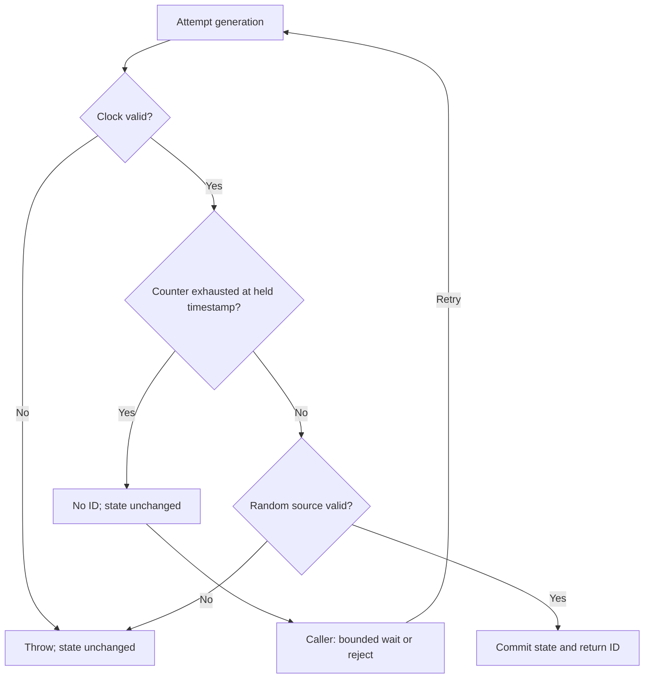

# ADR-0002: UUIDv7 Sortable Generation

## Status

Accepted. Evidence and deployment coverage remain separate from this decision.

## Context

### Background and Problem Statement

The existing sortable generator predates RFC 9562 and encodes a different
timestamp layout while setting version-7 bits. A 12-bit sequence can wrap.
Consumers need interoperable time-oriented IDs and explicit exhaustion behavior.

### Current Limitations

Version and variant bits cannot distinguish the old layout from conforming
UUIDv7 values. Independent generators and clocks do not establish global order.

## Decision Drivers

### Primary Decision Drivers

- Produce RFC 9562 UUIDv7 bytes and prevent silent sequence rollover.
- Define clock rollback, restart, and ownership boundaries.

### Secondary Decision Drivers

- Keep explicit random and clock injection for reproducible tests.
- Keep sortable generation synchronous without blocking the event loop.

## Considered Options

### Option 1: UUIDv7 with a guarded counter

**Description:** Use the RFC timestamp, a seeded counter, and random tail.

**Technical Characteristics:** Ordering is per generator with bounded capacity.

**Advantages:** Standard UUID layout and explicit failure behavior.

**Disadvantages:** Restarts and independent generators require separate policy.

**Risk Assessment:** Timestamp and counter state can be exposed or lost.

### Option 2: Keep the older layout

**Description:** Continue emitting the pre-standard sortable bit layout.

**Technical Characteristics:** Existing values remain recognizable to its owner.

**Advantages:** No generator-format change.

**Disadvantages:** UUIDv7 timestamps are not interoperable.

**Risk Assessment:** Misinterpreting the timestamp can corrupt ordering
semantics.

## Decision

Adopt option 1 with no old-layout reader, adapter, or automatic detection.
Rejecting the previous node-prefix option is a project profile choice, not a
claim that RFC 9562 requires a separate flake class. The historical option
placed caller-provided leading bits in the random tail. An injected random
source can still influence UUIDv7 bytes, but does not itself allocate workers or
supply a coordinated uniqueness guarantee.

<a id="REQ-ID-UUID7-001"></a>

### REQ-ID-UUID7-001 - Layout

Status: active<br> Normative Level: MUST<br> Verification Class:
interoperability<br> Evidence Status: partial

The sortable generator MUST encode a 48-bit big-endian Unix millisecond
timestamp, version 7, a 12-bit counter, RFC variant bits, and 62 random bits. It
MUST reject non-finite, negative, and out-of-range timestamps.

```text
 0                   1                   2                   3
 0 1 2 3 4 5 6 7 8 9 0 1 2 3 4 5 6 7 8 9 0 1 2 3 4 5 6 7 8 9 0 1
-+-+-+-+-+-+-+-+-+-+-+-+-+-+-+-+-+-+-+-+-+-+-+-+-+-+-+-+-+-+-+-+
|                         unix_ts_ms                            |
-+-+-+-+-+-+-+-+-+-+-+-+-+-+-+-+-+-+-+-+-+-+-+-+-+-+-+-+-+-+-+-+
|          unix_ts_ms           |  0111 |      sequence         |
-+-+-+-+-+-+-+-+-+-+-+-+-+-+-+-+-+-+-+-+-+-+-+-+-+-+-+-+-+-+-+-+
|1 0|                       random tail                         |
-+-+-+-+-+-+-+-+-+-+-+-+-+-+-+-+-+-+-+-+-+-+-+-+-+-+-+-+-+-+-+-+
|                          random tail                          |
-+-+-+-+-+-+-+-+-+-+-+-+-+-+-+-+-+-+-+-+-+-+-+-+-+-+-+-+-+-+-+-+
```

Bytes 0 through 5 contain the timestamp; the low nibble of byte 6 and byte 7
contain the counter; byte 6 has version nibble 7; and byte 8 starts with variant
bits 10 followed by the random tail through byte 15. A fractional nonnegative
clock value is floored to milliseconds. The input must not exceed the maximum
48-bit timestamp even if flooring would otherwise produce an in-range integer.
The random source supplies exactly 10 bytes for each successful generation; its
first two bytes seed the counter and its remaining bytes provide the tail.

<a id="REQ-ID-UUID7-002"></a>

### REQ-ID-UUID7-002 - Counter and clock

Status: active<br> Normative Level: MUST<br> Verification Class:
monotonicity<br> Evidence Status: partial

For each later millisecond the generator MUST seed its counter from 11 random
bits with a clear guard bit. If time has not advanced, it MUST hold the previous
timestamp and increment the counter. It MUST throw a RangeError on exhaustion
before rollover, without committing partial state, and MAY resume after time
advances.

The initial counter is in the inclusive range 0 through 2047. Consequently a
fresh millisecond permits between 2049 and 4096 outputs, depending on that seed;
it is incorrect to promise a fixed 4096 outputs. A failed clock or random
source, invalid source result, or exhaustion MUST leave the last committed
generation state unchanged. Waiting or retrying is caller policy; generation
does not block until the clock advances.

The non-throwing attempt MUST return an ID on success and no value only on
counter exhaustion. It MUST propagate clock and random-source failures; invalid
clock values and invalid random results MUST still throw. The throwing API MUST
continue to raise RangeError on exhaustion. Neither attempt may partially commit
state. The following view is informative:



<a id="REQ-ID-UUID7-003"></a>

### REQ-ID-UUID7-003 - Restart and scope

Status: active<br> Normative Level: MUST<br> Verification Class: ownership<br>
Evidence Status: partial

Restart state MUST be a caller-supplied UUID from this profile. The generator
MUST copy state before returning and MUST validate available length, version,
and variant information. The caller MUST establish profile provenance and own
durable, exclusive state; bit checks cannot distinguish older or other profiles.
Monotonicity MUST NOT be claimed across independent generators or machines.

The restart input provides timestamp and counter state, not proof of origin or a
durable reservation. The last-generated accessor returns a copy and is
unavailable until this instance generates a value, even when restart state was
supplied. Exclusive use of the saved state and crash-safe persistence are
outside this generator. A timestamp reveals approximate creation time and can be
held ahead of the observed clock after rollback.

<a id="REQ-ID-UUID7-004"></a>

### REQ-ID-UUID7-004 - Node boundary

Status: active<br> Normative Level: MUST NOT<br> Verification Class:
profile-boundary<br> Evidence Status: partial

The UUIDv7 generator MUST NOT embed a fixed node ID. A separately specified
UUIDv8 profile owns any worker-scoped flake format.

This target moves the former variable-width node-prefix capability to the
separate configurable UUIDv8 flake. The version field alone does not enforce
worker exclusivity or identify an allocation policy.

## Consequences

### Positive

- Standard UUID consumers can interpret the timestamp field.

### Negative

- Old and new sortable values cannot be mixed for chronological ordering.

### Neutral

- Persistence, worker coordination, and global ordering remain caller concerns.

## Decision Outcome

Use RFC UUIDv7 with explicit per-generator monotonicity and exhaustion.

## Related Decisions

- [Identifier values](../0001-identifier-values-and-representations/adr.md).
- [Worker-scoped flakes](../0003-uuidv8-worker-scoped-flakes/adr.md).

## Links

- [Sortable generator](../../src/IdSortable.ts).
- [Sortable tests](../../tests/IdSortable.test.ts).

## More Information

RFC 9562 defines UUIDv7 and permits guarded counters for monotonicity. The
[assurance graph](requirements.yml) records selected vectors, state cases, and
execution bindings. The pinned historical benchmark is an adapted instrument,
not an old-format production reader or a controlled performance guarantee.

## Audit

### 2026-11-26

**Status:** Partial

**Findings:**

| Finding                                                            | Files                                   | Lines | Assessment |
| ------------------------------------------------------------------ | --------------------------------------- | ----- | ---------- |
| Local generator and targeted tests exist                           | [Generator](../../src/IdSortable.ts)    | -     | partial    |
| Cross-runtime and independent interoperability evidence is pending | [Tests](../../tests/IdSortable.test.ts) | -     | pending    |

**Summary:** The local targeted tests ran before the latest dependency refresh.

**Action Required:** Verify the refreshed build, vectors, runtime boundaries,
and release contract.

### 2026-11-26

**Status:** Partial

**Findings:**

| Finding                                            | Files                                   | Lines | Assessment |
| -------------------------------------------------- | --------------------------------------- | ----- | ---------- |
| Exhaustion uses a generic RangeError               | [Generator](../../src/IdSortable.ts)    | -     | partial    |
| Restart exhaustion and RFC vector have local tests | [Tests](../../tests/IdSortable.test.ts) | -     | partial    |

**Summary:** The proposed error requirement now names the native error type; no
custom error class or error-package dependency is required.

**Action Required:** Review the proposed record and runtime evidence before
release.

### 2026-11-26

**Status:** Partial

**Findings:**

| Finding                                                | Files                                                | Lines | Assessment |
| ------------------------------------------------------ | ---------------------------------------------------- | ----- | ---------- |
| RFC vector, failure, rollback, and restart cases exist | [Tests](../../tests/IdSortable.test.ts)              | -     | partial    |
| Frozen-clock behavior is exercised in Chromium         | [Browser scenario](../../tests/browser/scenarios.ts) | -     | partial    |

**Summary:** Local tests and the Chromium check passed for selected cases; they
do not establish global ordering, a deployment guarantee, or a performance
budget.

**Action Required:** Review profile provenance and downstream persisted state.

### 2026-11-26

**Status:** Partial

**Findings:**

| Finding                                 | Files                               | Lines | Assessment |
| --------------------------------------- | ----------------------------------- | ----- | ---------- |
| Decision accepted; requirements active  | [Record](adr.md)                    | -     | partial    |
| Evidence gaps remain separately tracked | [Assurance graph](requirements.yml) | -     | partial    |

**Summary:** The owner accepted this decision. Acceptance does not establish
conformance, deployment, or an immutable execution receipt. Previous audit
entries remain historical.

**Action Required:** Review remaining evidence gaps and attach execution
receipts when available.
