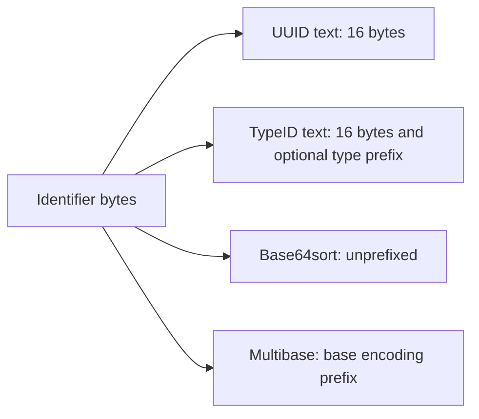

# ADR-0004: Typed and Compact Identifier Encodings

## Status

Accepted. Full conformance and release remain separate from this decision.

## Context

### Background and Problem Statement

Consumers need compact, recognizable, strongly typed representations of byte
identifiers. UUID text, multibase, and TypeID have different type and encoding
semantics. Sortability depends on both the alphabet and comparison collation.

### Current Limitations

The current UUID parser accepted malformed text. Subclass factories construct
the base class. The multibase registry does not list sortable base64.

## Decision Drivers

### Primary Decision Drivers

- Reject malformed and noncanonical input without changing the represented
  bytes.
- Provide semantic typing and compact lexicographically ordered text.

### Secondary Decision Drivers

- Interoperate with TypeID without confusing its prefix with multibase.
- Preserve arbitrary-length byte identifiers where a profile permits them.

## Considered Options

### Option 1: Explicit independent encoding profiles

**Description:** Specify UUID text, sortable base64, and TypeID separately.

**Technical Characteristics:** Each parser owns its format and validation.

**Advantages:** Formats remain explicit and independently interoperable.

**Disadvantages:** Consumers must choose a representation and type namespace.

**Risk Assessment:** Incorrect assumptions about collation can change ordering.

### Option 2: Treat every format as multibase

**Description:** Assign all typed and sortable forms to multibase prefixes.

**Technical Characteristics:** A single prefix namespace drives decoding.

**Advantages:** One apparent parser entrypoint.

**Disadvantages:** TypeID prefixes and unregistered codecs are not multibase
codes.

**Risk Assessment:** Conflicting assignments can cause incorrect decoding.

## Decision

Adopt option 1, with explicit subtype and domain-prefix boundaries.

### REQ-ID-ENCODING-001 - Strict UUID syntax

Status: active  Normative Level: MUST  Verification Class: parsing 
Evidence Status: partial

UUID text parsing MUST accept exactly 32 hexadecimal digits in the canonical
8-4-4-4-12 hyphen positions, accepting either hexadecimal case. Malformed text
MUST be rejected without coercing invalid bytes. General syntax parsing MUST NOT
silently add a version or variant restriction.

The encoder emits lowercase canonical text and requires 16 bytes. The parser
returns no value for invalid text; accepting valid syntax does not establish a
generator profile, provenance, or semantic identifier type.

The following encoding view is informative; text formats and their prefixes are
separate, not interchangeable:

### REQ-ID-ENCODING-002 - Sortable base64

Status: active  Normative Level: MUST  Verification Class:
ordering-and-roundtrip  Evidence Status: unevidenced

The compact sortable base64 codec MUST use the ASCII-ordered alphabet
`-0123456789ABCDEFGHIJKLMNOPQRSTUVWXYZ_abcdefghijklmnopqrstuvwxyz`, encode bits
most-significant first, default to unpadded output, and support the draft's
optional `=` and `~` padding. It MUST reject invalid alphabet, padding, length,
and nonzero unused trailing bits. For equal-length values using the same padding
convention, text order under binary ASCII collation MUST match unsigned byte
order. This codec MUST NOT claim an unregistered multibase prefix. A 16-byte
value encodes to 22 unpadded characters.

Empty input is valid. A decoder MUST reject mixed, misplaced, or incorrectly
sized padding and unpadded input with a length congruent to 1 modulo 4. Ordering
is not promised across different input lengths, mixed padding conventions,
locale-sensitive collations, case-folded indexes, or other base64 alphabets. The
registered multibase codecs remain separate and keep their own prefixes.

The alphabet matches the individual
[Base64sort Internet-Draft](https://www.ietf.org/archive/id/draft-brown-davis-base64-sort-01.html),
which expired in October 2026 and is not an RFC. Its padded and unpadded
examples are included in local tests. The
[multibase registry](https://raw.githubusercontent.com/multiformats/multibase/master/multibase.csv)
does not list Base64sort; it lists base32hex as experimental.

### REQ-ID-ENCODING-003 - TypeID interoperability

Status: active  Normative Level: MUST  Verification Class:
external-vectors  Evidence Status: unevidenced

Any TypeID-compatible profile MUST follow TypeID specification 0.3 prefix,
separator, alphabet, canonical length, overflow, and byte-order rules, and use
UUIDv7 for newly generated TypeIDs. Encoding supplied non-v7 bytes MUST be
distinguished from generating a conforming TypeID.

The suffix is 26 lowercase Crockford base32 characters representing two leading
zero bits and 128 UUID bits. The optional prefix is at most 63 lowercase ASCII
letters or underscores, starts and ends with a letter, and is separated from the
suffix by an underscore. Empty prefix omits the separator. Decoding accepts
canonical supplied UUID bytes without asserting version 7; the codec itself does
not generate UUIDs or allocate semantic prefixes.

### REQ-ID-ENCODING-004 - Subtype construction

Status: active  Normative Level: MUST  Verification Class:
runtime-and-types  Evidence Status: unevidenced

Supported identifier subclass factories and decoders MUST construct the invoked
subclass and preserve its declared TypeScript identity. Tests MUST cover subtype
construction, incompatible domain types, encoding, and mutable-byte ownership.

The receiver class constructs the resulting instance for its supported static
factories and decoders. A generator's generic type parameter is a compile-time
brand and does not choose a runtime subclass. Buffer-backed subclass decoding
shares the original view; decoding text constructs new bytes.

## Consequences

### Positive

- Text formats and semantic types become explicit and independently testable.

### Negative

- The unpadded Base64sort profile requires a documented interoperability
  contract.

### Neutral

- Prefix allocation remains coordinated at application and protocol boundaries.

## Decision Outcome

Specify separate strict encoding profiles with no invented multibase assignment.

## Related Decisions

- [Identifier values](../0001-identifier-values-and-representations/adr.md).

## Links

- [Identifier value](../../src/Id.ts).
- [Encoding utilities](../../src/utils.ts).
- [Current compatibility tests](../../tests/compatibility.test.ts).

## More Information

TypeID 0.3 uses a fixed 26-character suffix and a separate semantic type prefix.
Its alphabet and bit placement are not the sortable base64 profile above. The
[assurance graph](requirements.yml) links selected upstream TypeID vectors,
malformed-input cases, and type tests without claiming complete
interoperability.

Multibase transports bytes, but does not by itself establish CID semantics.
CIDv1 adds version, content-type multicodec, and multihash fields; CIDv0 has a
special unprefixed text form. See the
[CID specification](https://specs.ipfs.tech/cid/). The library does not validate
CID structure or implement IPFS retrieval.

## Audit

### 2026-11-26

**Status:** Partial

**Findings:**

| Finding                                                    | Files                                      | Lines | Assessment |
| ---------------------------------------------------------- | ------------------------------------------ | ----- | ---------- |
| Strict UUID syntax has local regression tests              | [Tests](../../tests/compatibility.test.ts) | -     | partial    |
| Sortable base64, subtype, and TypeID contracts are pending | -                                          | -     | pending    |

**Summary:** UUID tests passed before the dependency refresh; other profiles are
targets.

**Action Required:** Implement and verify canonical vectors and type boundaries.

### 2026-11-26

**Status:** Partial

**Findings:**

| Finding                                                         | Files                              | Lines | Assessment |
| --------------------------------------------------------------- | ---------------------------------- | ----- | ---------- |
| Sortable base64 has local ordering and round-trip tests         | [Tests](../../tests/utils.test.ts) | -     | partial    |
| TypeID codec passes selected official valid and invalid vectors | [Tests](../../tests/utils.test.ts) | -     | partial    |
| Subclass construction remains to be implemented                 | [ID value](../../src/Id.ts)        | -     | pending    |

**Summary:** The full local suite passed 83 tests with no reported type errors.
The TypeID codec does not generate UUIDs, and cross-runtime and external package
integration checks remain outstanding.

**Action Required:** Verify subtype construction and supported runtime and
package boundaries.

### 2026-11-26

**Status:** Partial

**Findings:**

| Finding                                         | Files                                  | Lines | Assessment |
| ----------------------------------------------- | -------------------------------------- | ----- | ---------- |
| Subclass factories and type cases now exist     | [Type tests](../../tests/Id.test-d.ts) | -     | partial    |
| Canonical codec and selected TypeID cases exist | [Tests](../../tests/utils.test.ts)     | -     | partial    |

**Summary:** The earlier pending subtype finding describes the prior state, not
the current working tree. External consumer integration remains unverified.

**Action Required:** Review the target and remaining integration boundaries.

### 2026-11-26

**Status:** Partial

**Findings:**

| Finding                                                | Files                              | Lines | Assessment |
| ------------------------------------------------------ | ---------------------------------- | ----- | ---------- |
| Draft examples and CID byte transport have local cases | [Tests](../../tests/utils.test.ts) | -     | partial    |
| CID semantic validation is outside the codec           | [Utilities](../../src/utils.ts)    | -     | partial    |

**Summary:** The draft alignment extends this proposed codec from its earlier
unpadded-only target to optional padded forms. The expired individual draft and
multibase registry do not prove deployed protocol interoperability.

**Action Required:** Review actual consumer collations and protocol boundaries.

### 2026-11-26

**Status:** Partial

**Findings:**

| Finding                                 | Files                               | Lines | Assessment |
| --------------------------------------- | ----------------------------------- | ----- | ---------- |
| Decision accepted; requirements active  | [Record](adr.md)                    | -     | partial    |
| Evidence gaps remain separately tracked | [Assurance graph](requirements.yml) | -     | partial    |

**Summary:** The owner accepted this decision. Acceptance does not establish
conformance, deployment, or an immutable execution receipt. Previous audit
entries remain historical.

**Action Required:** Review remaining evidence gaps and attach execution
receipts when available.
