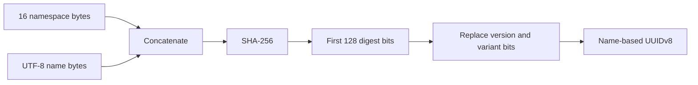

# ADR-0005: Name-Based UUIDv8 Identifiers

## Status

Accepted. This custom UUIDv8 profile has selected local test evidence;
acceptance does not itself establish a release or conformance.

## Context

### Background and Problem Statement

Deterministic IDs bind canonical names to namespaces. Existing UUIDv5 uses
SHA-1; RFC 9562 requires newer name-based hash profiles to use UUIDv8.

### Current Limitations

Changing hashing or namespace derivation changes identifier bytes. Deterministic
values do not by themselves provide authentication or protect low-entropy names.

## Decision Drivers

### Primary Decision Drivers

- Specify a reproducible SHA-256 name-based UUIDv8 profile.
- Avoid representing SHA-256 output as UUIDv5.

### Secondary Decision Drivers

- Support interoperable byte order and deterministic test vectors.
- Explicitly state name normalization and security limitations.

## Considered Options

### Option 1: SHA-256 UUIDv8 profile

**Description:** Hash a namespace and canonical name with SHA-256.

**Technical Characteristics:** Apply UUIDv8 and variant bits to truncated
output.

**Advantages:** Uses a modern hash and follows the RFC version boundary.

**Disadvantages:** Existing deterministic UUIDv5 values differ.

**Risk Assessment:** Name and namespace ambiguity changes the resulting
identity.

### Option 2: SHA-256 with UUIDv5 bits

**Description:** Change the hash while retaining the version-5 marker.

**Technical Characteristics:** The output appears to be standard UUIDv5.

**Advantages:** Existing version checks would see version 5.

**Disadvantages:** The output is not conforming UUIDv5.

**Risk Assessment:** Interoperating systems derive different bytes.

## Decision

Adopt option 1 with an explicitly documented project profile.

<a id="REQ-ID-NAME-001"></a>

### REQ-ID-NAME-001 - Hash profile

Status: active<br> Normative Level: MUST<br> Verification Class:
hash-vectors<br> Evidence Status: unevidenced

The SHA-256 name-based profile MUST hash the 16 namespace UUID bytes in network
byte order followed by the canonical name bytes, take the first 16 digest bytes,
and set UUIDv8 and RFC variant bits. The namespace and input conversion MUST be
explicit, deterministic, and documented; UUIDv8 bits alone do not identify the
hash algorithm or namespace policy.

```text
 0                   1                   2                   3
 0 1 2 3 4 5 6 7 8 9 0 1 2 3 4 5 6 7 8 9 0 1 2 3 4 5 6 7 8 9 0 1
-+-+-+-+-+-+-+-+-+-+-+-+-+-+-+-+-+-+-+-+-+-+-+-+-+-+-+-+-+-+-+-+
|                        digest bits 0..31                      |
-+-+-+-+-+-+-+-+-+-+-+-+-+-+-+-+-+-+-+-+-+-+-+-+-+-+-+-+-+-+-+-+
|       digest bits 32..47      |  1000 |  digest bits 52..63   |
-+-+-+-+-+-+-+-+-+-+-+-+-+-+-+-+-+-+-+-+-+-+-+-+-+-+-+-+-+-+-+-+
|1 0|                    digest bits 66..95                     |
-+-+-+-+-+-+-+-+-+-+-+-+-+-+-+-+-+-+-+-+-+-+-+-+-+-+-+-+-+-+-+-+
|                       digest bits 96..127                     |
-+-+-+-+-+-+-+-+-+-+-+-+-+-+-+-+-+-+-+-+-+-+-+-+-+-+-+-+-+-+-+-+
```

The fixed version and variant replace digest bits 48 through 51 and 64 through
65, respectively. The remaining bits are taken from the first 128 digest bits.

For the byte-namespace case, the derivation is:



For a byte namespace, the input MUST contain exactly 16 bytes and the generator
MUST copy it. A string namespace is first encoded as a name under the all-zero
UUID namespace using this same profile. For example, the RFC Appendix B.2 DNS
namespace and `www.example.com` produce `5c146b14-3c52-8afd-938a-375d0df1fbf6`.
This vector uses a byte namespace; it does not specify the separate
string-namespace derivation rule.

<a id="REQ-ID-NAME-002"></a>

### REQ-ID-NAME-002 - Name canonicalization

Status: active<br> Normative Level: MUST<br> Verification Class:
cross-runtime<br> Evidence Status: unevidenced

String names MUST use documented UTF-8 conversion. The API MUST specify whether
any Unicode normalization is applied and MUST NOT silently equate different
names through undocumented transformations.

The profile uses TextEncoder UTF-8 conversion without Unicode normalization;
unpaired UTF-16 surrogates are replaced as specified by that encoder. Callers
who need case folding, normalization, or structured-name canonicalization MUST
do so explicitly and consistently before invoking the generator.

<a id="REQ-ID-NAME-003"></a>

### REQ-ID-NAME-003 - Security boundary

Status: active<br> Normative Level: MUST NOT<br> Verification Class:
security-boundary<br> Evidence Status: unevidenced

The name-based UUID MUST NOT be presented as a credential, secret, password
hash, or collision-proof proof of a name. Changing namespace or name changes the
identifier and requires a consuming-domain decision.

## Consequences

### Positive

- SHA-256 output is labeled as a custom UUIDv8 profile.

### Negative

- The hard cut changes deterministic output for existing inputs.

### Neutral

- Standard UUIDv5 remains a separate standardized algorithm if offered.

## Decision Outcome

Use an explicitly specified SHA-256 UUIDv8 profile for modern name-based IDs.

## Related Decisions

- [Identifier values](../0001-identifier-values-and-representations/adr.md).
- [Cross-runtime boundaries](../0006-cross-runtime-boundaries/adr.md).

## Links

- [Current deterministic generator](../../src/IdDeterministic.ts).
- [Current deterministic tests](../../tests/IdDeterministic.test.ts).

## More Information

RFC 9562 Appendix B.2 provides an illustrative SHA-256 name-based UUIDv8 vector.
The [assurance graph](requirements.yml) distinguishes the RFC vector,
independent Node hash comparisons, and selected browser execution from
exhaustive proof.

## Audit

### 2026-11-26

**Status:** Pending

**Findings:**

| Finding                       | Files                                     | Lines | Assessment |
| ----------------------------- | ----------------------------------------- | ----- | ---------- |
| Current generator uses UUIDv5 | [Generator](../../src/IdDeterministic.ts) | -     | pending    |

**Summary:** The proposed SHA-256 profile is not implemented or verified.

**Action Required:** Select input APIs and prove RFC and cross-runtime vectors.

### 2026-11-26

**Status:** Partial

**Findings:**

| Finding                                                       | Files                                        | Lines | Assessment |
| ------------------------------------------------------------- | -------------------------------------------- | ----- | ---------- |
| Byte namespaces match the RFC Appendix B.2 vector             | [Tests](../../tests/IdDeterministic.test.ts) | -     | partial    |
| SHA-256 inputs are checked against Node's hash implementation | [Tests](../../tests/IdDeterministic.test.ts) | -     | partial    |
| Synchronous SHA-256 replaces the UUID package dependency      | [Generator](../../src/IdDeterministic.ts)    | -     | partial    |

**Summary:** The generator copies 16-byte namespaces and derives string
namespaces from the nil UUID using the same profile. UTF-8 conversion uses
standard replacement of unpaired surrogates without normalization. Node tests
pass; the updated browser and dedicated-worker vectors remain to be rerun.

**Action Required:** Verify cross-runtime vectors, performance, and downstream
hard-cut decisions for persisted deterministic IDs.

### 2026-11-26

**Status:** Partial

**Findings:**

| Finding                                                       | Files                                                | Lines | Assessment |
| ------------------------------------------------------------- | ---------------------------------------------------- | ----- | ---------- |
| The RFC vector runs in Chromium document and dedicated worker | [Browser scenario](../../tests/browser/scenarios.ts) | -     | partial    |
| Historical deterministic IDs require consumer decisions       | [Assurance](requirements.yml)                        | -     | pending    |

**Summary:** Local Node and selected Chromium executions passed; earlier audit
entries record historical implementation and verification state.

**Action Required:** Review cutover and verify any additional claimed runtime.

### 2026-11-26

**Status:** Partial

**Findings:**

| Finding                                 | Files                               | Lines | Assessment |
| --------------------------------------- | ----------------------------------- | ----- | ---------- |
| Decision accepted; requirements active  | [Record](adr.md)                    | -     | partial    |
| Evidence gaps remain separately tracked | [Assurance graph](requirements.yml) | -     | partial    |

**Summary:** The owner accepted this decision. Acceptance does not establish
conformance, deployment, or an immutable execution receipt. Previous audit
entries remain historical.

**Action Required:** Review remaining evidence gaps and attach execution
receipts when available.

### 2026-11-26

**Status:** Partial

**Findings:**

| Finding                          | Files                                        | Lines | Assessment |
| -------------------------------- | -------------------------------------------- | ----- | ---------- |
| SHA-256 source is vendored       | [Generator](../../src/IdDeterministic.ts)    | -     | partial    |
| Standard and independent vectors | [Tests](../../tests/IdDeterministic.test.ts) | -     | partial    |
| Upstream MIT license is retained | [License](../../LICENSE.noble-hashes)        | -     | partial    |

**Summary:** The synchronous name-based API needs SHA-256 in Node, browsers, and
workers; Web Crypto's asynchronous digest would change that API. Instead of
fetching a runtime package solely for this hash, the project vendors the
required Noble modules from version 2.4.0 at commit
`663c2aeeffc308ac0cded59bd32f7c212adacfc2`. Their source bytes match upstream;
TypeScript rewrites relative import extensions in emitted JavaScript. The files
include shared utilities and other SHA-2 variants because retaining whole
upstream modules makes provenance and future comparisons straightforward. The
MIT notice is included in the distribution allowlist.

Vendoring reduces runtime dependency acquisition but transfers responsibility
for upstream security updates, provenance review, and license preservation to
this project. Noble's published audit refers to version 1.0.0; it is not an
audit of this version or its integration. The UUIDv8 hash profile and output
bytes are unchanged. Node vector and differential tests passed; runtime and
performance evidence remain separate from this source comparison.

**Action Required:** Verify the browser and worker paths and review upstream
updates when maintaining the vendored source.

## Vendored source maintenance

The initial source is [noble-hashes 2.4.0 at commit
663c2aeeffc308ac0cded59bd32f7c212adacfc2](https://github.com/paulmillr/noble-hashes/tree/663c2aeeffc308ac0cded59bd32f7c212adacfc2).
The vendored source directory contains the complete upstream `sha2.ts`,
`_md.ts`, `_u64.ts`, and `utils.ts` modules. The [generator](../../src/IdDeterministic.ts)
records the selected version and commit. These are upstream source files, not a
claim that this particular version or integration was independently audited.

When updating the vendored implementation:

1. Review upstream releases, security fixes, compatibility, and licensing.
   Select a specific upstream release and resolve its tag to an exact commit;
   record both in the generator's provenance comment and in a new audit entry.
2. Inspect the selected SHA-256 module's transitive imports. Copy complete
   required upstream source modules verbatim at that commit, adding or removing
   modules if its dependency closure has changed. Do not format or otherwise
   edit the copies. Compare every copied file byte-for-byte against the selected
   commit, including any newly required modules.
3. Review and retain the applicable upstream license and notices, and ensure
   they remain included in the published file allowlist. Check that the lint
   exclusion and TypeScript import-extension rewriting still cover the vendored
   files, without changing the upstream source bytes.
4. Review the upstream diff and the synchronous generator integration. Run the
   standard SHA-256 vectors, streaming and Node differential tests, deterministic
   UUIDv8 vectors, declaration checks, and the Node, browser, and local Worker
   checks. Investigate performance regressions when the change warrants it.
   Record which checks actually ran and any unsupported runtime boundaries.
5. Preserve the documented namespace and name conversion, hash profile, and
   existing output bytes. If a proposed change affects them, treat it as an
   identity migration requiring a separate decision, not a routine vendor
   update. Release the reviewed change normally without moving an existing tag.
