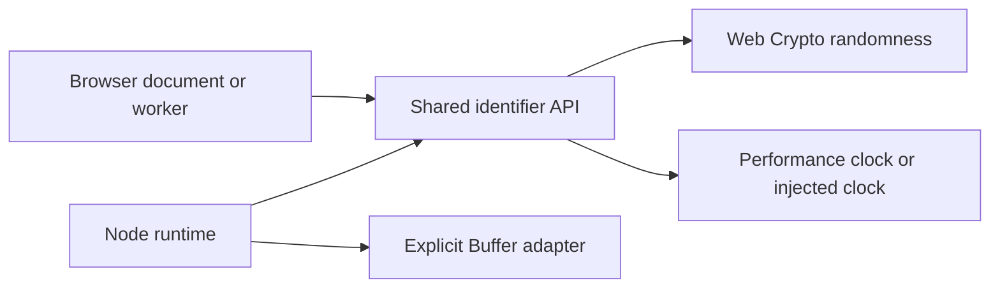

# ADR-0006: Cross-Runtime Identifier Boundaries

## Status

Accepted. Selected Node, Chromium document, and dedicated-worker executions
exist; a deployed Cloudflare Worker and other browser engines remain unverified.

## Context

### Background and Problem Statement

Identifier creation and parsing are needed in Node, browser, and Worker
applications. The current shared utility graph imports Node-specific modules.

### Current Limitations

Node Buffer conversion, synchronous hashing, secure randomness, and clocks have
different runtime APIs and cannot be assumed equivalent without evidence.

## Decision Drivers

### Primary Decision Drivers

- Make the intended shared package surface usable in all selected runtimes.
- Require secure randomness without silent insecure fallback.

### Secondary Decision Drivers

- Preserve explicit effects and avoid silently changing synchronous contracts.
- Verify actual compiled artifacts and transitive runtime imports.

## Considered Options

### Option 1: Shared neutral core and explicit adapters

**Description:** Keep shared byte operations neutral and isolate runtime
adapters.

**Technical Characteristics:** Runtime-specific facilities are selected at
boundaries.

**Advantages:** Shared contracts work without Node-only imports.

**Disadvantages:** Runtime-specific conversion and hashing need explicit design.

**Risk Assessment:** A dependency may still import incompatible transitive code.

### Option 2: Node-only package

**Description:** Retain the current Node-only dependency graph.

**Technical Characteristics:** Crypto, clock, and Buffer use Node facilities.

**Advantages:** No cross-runtime refactor is required.

**Disadvantages:** Browser and Worker applications need separate
implementations.

**Risk Assessment:** Downstream integrations may falsely assume portability.

## Decision

Adopt option 1 with explicit runtime evidence and no insecure fallback.

### REQ-ID-RUNTIME-001 - Neutral import graph

Status: active  Normative Level: MUST  Verification Class:
runtime-imports  Evidence Status: unevidenced

The shared identifier entrypoint MUST import and execute in supported Node,
browser, and Worker environments without requiring Node-only builtins. Any
Node-specific Buffer adapter MUST be explicit and MUST document byte ownership.

The shared entrypoint and its runtime dependency graph must not require a Buffer
polyfill for byte, UUID, multibase, compact-codec, or generator operations.
Buffer conversion is a Node-specific operation, not a prerequisite for importing
the shared API. Its views share memory and preserve offsets. Browser bundling is
an integration binding, not evidence for every possible bundler or deployment.

The runtime boundary below is informative, not a claim that every browser or
deployed Worker has been tested:

### REQ-ID-RUNTIME-002 - Secure randomness

Status: active  Normative Level: MUST  Verification Class: randomness 
Evidence Status: unevidenced

Default random generation MUST use a runtime cryptographically suitable source
and MUST fail explicitly if unavailable. Injectable sources MUST have documented
length and ownership contracts and MUST NOT be represented as secure by default.

The default source uses Web Crypto and splits requests into chunks of at most
65536 bytes. No Math.random fallback is permitted. UUIDv4's injected source must
supply at least 16 bytes and its version and variant bits are written into that
source before the ID bytes are copied; UUIDv7 requires exactly 10 bytes. The
caller is responsible for the quality and availability of injected sources.

### REQ-ID-RUNTIME-003 - Runtime evidence

Status: active  Normative Level: MUST  Verification Class: integration 
Evidence Status: unevidenced

Runtime support MUST be demonstrated using the compiled package and its actual
dependency graph in each claimed runtime. Tests MUST include generation, strict
parsing, byte ownership, and applicable deterministic vectors.

The documented default clock combines performance time origin and current
performance time; consumers may inject a clock. A runtime can freeze or coarsen
time, so generators must apply their documented bounded-counter behavior rather
than assume a synchronous clock advance. Chromium's frozen-clock fixture is a
simulation, not a deployed Cloudflare Worker test. Claims for other engines or a
deployed Worker require their own observed execution and environment.

## Consequences

### Positive

- Shared identifiers can be used at actual application boundaries.

### Negative

- Hashing and Node Buffer adapters require explicit runtime contracts.

### Neutral

- This record does not mandate a particular bundler or dependency
  implementation.

## Decision Outcome

Use a neutral core, explicit adapters, and real runtime-boundary evidence.

## Related Decisions

- [Identifier values](../0001-identifier-values-and-representations/adr.md).
- [Name-based UUIDv8](../0005-name-based-uuidv8/adr.md).

## Links

- [Current utility graph](../../src/utils.ts).
- [Package manifest](../../package.json).

## More Information

Runtime support is not implied by a successful Node-only unit test. The
[assurance graph](assurance.json) records execution bindings and explicit gaps.
No package archive test or deployed Cloudflare check is implied.

## Audit

### 2026-11-26

**Status:** Pending

**Findings:**

| Finding                                   | Files                           | Lines | Assessment |
| ----------------------------------------- | ------------------------------- | ----- | ---------- |
| Shared utilities import Node-only modules | [Utilities](../../src/utils.ts) | -     | pending    |

**Summary:** No actual browser or Worker execution has been verified.

**Action Required:** Implement boundaries and run the applicable runtime tests.

### 2026-11-26

**Status:** Partial

**Findings:**

| Finding                                                          | Files                                         | Lines | Assessment |
| ---------------------------------------------------------------- | --------------------------------------------- | ----- | ---------- |
| Node tests cover Web Crypto chunking and restart clock behavior  | [Tests](../../tests/utils.test.ts)            | -     | partial    |
| Chromium document and dedicated worker run the compiled library  | [Browser check](../../nix/checks/browser.nix) | -     | partial    |
| Deployed Cloudflare and other browser runtimes remain unverified | -                                             | -     | pending    |

**Summary:** The shared utility graph no longer imports Node builtins. Buffer
conversion remains Node-specific. The hermetic browser integration check passed
without a Buffer polyfill; it does not establish deployed-platform behavior.

**Action Required:** Verify the remaining runtime boundaries and deterministic
SHA-256 profile.

### 2026-11-26

**Status:** Partial

**Findings:**

| Finding                                                         | Files                                                | Lines | Assessment |
| --------------------------------------------------------------- | ---------------------------------------------------- | ----- | ---------- |
| Compiled SHA-256 and frozen-clock cases run in Chromium         | [Browser scenario](../../tests/browser/scenarios.ts) | -     | partial    |
| Deployed Cloudflare and other browser engines are not exercised | [Assurance](assurance.json)                          | -     | pending    |

**Summary:** The Chromium document and dedicated worker check passed without a
Buffer polyfill; this does not establish deployed-platform behavior.

**Action Required:** Gather platform-specific evidence before broader support
claims.

### 2026-11-26

**Status:** Partial

**Findings:**

| Finding                                 | Files                             | Lines | Assessment |
| --------------------------------------- | --------------------------------- | ----- | ---------- |
| Decision accepted; requirements active  | [Record](adr.md)                  | -     | partial    |
| Evidence gaps remain separately tracked | [Assurance graph](assurance.json) | -     | partial    |

**Summary:** The owner accepted this decision. Acceptance does not establish
conformance, deployment, or an immutable execution receipt. Previous audit
entries remain historical.

**Action Required:** Review remaining evidence gaps and attach execution
receipts when available.

### 2026-11-26

**Status:** Partial

**Findings:**

| Finding                                                | Files                                    | Lines | Assessment |
| ------------------------------------------------------ | ---------------------------------------- | ----- | ---------- |
| Default epoch sampling supports a wall-clock fallback  | [Clock](../../src/clock.ts)              | -     | partial    |
| Fallback and invalid readings have deterministic tests | [Clock tests](../../tests/clock.test.ts) | -     | partial    |
| Deployed Worker evidence is still absent               | [Assurance](assurance.json)              | -     | pending    |

**Summary:** The default source uses the performance clock when usable and falls
back to the wall clock otherwise. An invalid fallback is an error. Generator
rollback and exhaustion handling remains unchanged. This observation does not
establish deployed-platform conformance.

**Action Required:** Verify runtime-specific behavior and retain execution
receipts before making broader support claims.
